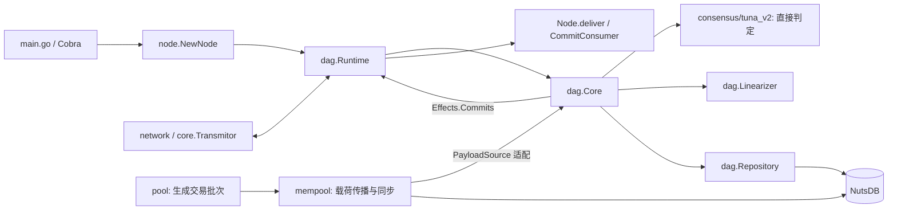

# Tuna_v2 项目入门指南

基于 2026-10-27 的当前工作区整理。项目的 Go 模块名为 `Tuna_v2`，阅读和新增导入时都要使用 `Tuna_v2/...` 前缀。

## 项目做什么

Tuna_v2 是用于协议研究与压测的 Go DAG 共识项目。当前实现了未认证 DAG、三轮直接判定、多提案者流水线、载荷同步、有序提交和重启恢复；`pool/` 自动生成测试交易，程序入口是节点 CLI。

**未决一致性新机制尚未实现。** 第一个 `Undecided` 会阻塞有序提交，但节点仍可收块、同步、出块和判定后续槽位；迟到的直接证据可能解除阻塞，也可能长期无法解除。`dag.UnresolvedResolver` 目前只是接口，运行路径没有安装或调用它。设计背景见 [PLAN.md](PLAN.md)，完整运行说明见 [readme.md](readme.md)。

## 技术栈

| 层次 | 技术与版本依据 |
| --- | --- |
| 语言与构建 | Go，`go.mod` 声明 `1.21.1`；使用 Go modules 和标准构建工具 |
| 命令行 | Cobra `v1.8.0`，见 `main.go` |
| 网络 | 自定义 TCP 消息，带长度上限的 Gob 帧；DAG 与 mempool 各有独立端口 |
| 存储 | NutsDB `v1.0.4`；`store.MemoryDB` 用于确定性测试，无 ORM |
| 密码学 | SHA-256、Ed25519；Kyber `v3.1.0` 提供可选门限签名工具 |
| 压测与测试 | Go `testing`、Python `unittest`；压测脚本依赖 Fabric `2.6.0` 和 tmux |

Python 未声明版本约束；本次使用 Python 3.10.12 验证日志测试。直接运行 Go 节点不需要 Python、Fabric 或 tmux。

## 架构与入口

这是一个 Go 模块，每个节点运行为独立进程，Python 工具负责组织实验。



`dag.Runtime.Run` 用一个事件循环管理 DAG 可变状态。网络、交易生成和载荷同步各有 goroutine，通过 channel 传递消息；`node.payloadBridge` 把 mempool 适配成 `dag.PayloadSource`。`dag` 定义 `Consensus`、`Reader` 等接口，由 `consensus/tuna_v2` 实现协议规则，避免包循环依赖。

| 目录或入口 | 阅读目的 |
| --- | --- |
| [main.go](main.go)、[config/config.go](config/config.go) | CLI 子命令、密钥与成员配置、参数加载及默认值 |
| [node/node.go](node/node.go) | `NewNode` 组装与恢复，`RunContext` 启动，`deliver` 输出提交 |
| [dag/types.go](dag/types.go)、[dag/core.go](dag/core.go)、[dag/runtime.go](dag/runtime.go) | 核心接口、状态推进、事件循环及区块同步 |
| `dag/block.go`、`block_manager.go`、`state.go`、`clock.go` | 编码验签、依赖暂存、DAG 索引、门限时钟 |
| [consensus/tuna_v2/](consensus/tuna_v2/) | `leader.go` 选举，`wave.go` 三轮映射，`base_committer.go` 直接判定，`committer.go` 槽位枚举 |
| [dag/linearizer.go](dag/linearizer.go)、[dag/repository.go](dag/repository.go) | 子 DAG 排序与去重、原子持久化、历史提交和恢复 |
| `core/`、`network/`、`store/`、`crypto/`、`logger/` | 成员地址簿、通用传输、存储、密码学和日志基础设施；`core/` 不是 DAG 核心 |
| `pool/`、`mempool/` | 生成批次，签名、传播、选择、补取载荷 |
| `benchmark/`、`examples/` | 本地及阿里云压测、日志分析、配置示例 |

## 跟踪一次收块到提交

1. `network.Codec` 解码 `dag.BlockMessage`，经 `core.Transmitor` 进入 `Runtime.receive`；`Core.Add` 调用 `Block.Verify` 检查域、成员、签名和引用规则，再进入 `BlockManager` 暂存。
2. `Core.Step → Drain` 等待父块全部接纳，并通过 `payloadBridge.Check` 检查载荷。缺块由 Runtime 请求，缺载荷由 mempool 同步；依赖齐备后先持久化区块，再更新 `State` 和门限时钟。
3. `Core.Step` 尝试本地出块，再调用 `Committer.Evaluate → BaseCommitter.Decide`，计算游标之后各槽位的直接判定，包括更晚的槽位。
4. `Core.Step` 按槽位顺序消费连续已判定前缀：遇 `Undecided` 停止；`DirectSkip` 只推进游标；`DirectCommit` 经 `Linearizer.Plan` 展开尚未交付的因果子 DAG。
5. `Repository.SaveDecision` 原子写入游标与提交记录，成功后应用去重状态。`Effects.Commits` 返回 Runtime，再由 `Node.deliver` 写 JSON 日志并发送给可选的 `CommitConsumer`。

## 修改前要理解的不变量

- **引用与顺序：** 区块由完整 `(round, author, digest)` 标识；同轮同作者的不同候选块都要保留。父引用顺序参与签名，并决定支持哪个候选块，不能随意重排。
- **门限与三轮：** 等权门限为 `floor(2N/3)+1`，按作者去重。第 `r` 轮提案，第 `r+1` 轮投票，第 `r+2` 轮形成证据；直接提交要求足量不同作者的区块各自携带足量支持票，只有一层票不够。
- **槽位与输出：** 成员按 ID 排序后轮转选举；槽位按 `(round, offset)` 消费。槽位判定和应用交付是不同阶段，已跳过槽位的候选块仍可作为后续因果历史的一部分交付。
- **确定性：** 线性化后的区块按 `(round, author, digest)` 排序，载荷按摘要去重；哈希采用规范字段编码，Gob 用于传输，不能替代规范哈希。
- **持久化：** 本地提案及自身提案指针在广播前原子保存；提交记录与游标在交付前原子保存。数据库绑定本地身份、成员公钥集合与 `leader_count`。
- **恢复消费：** 应用在 `RunContext` 前设置 `CommitConsumer`，先用 `ReadCommits(afterIndex)` 补读历史，再处理实时提交并按 `Index` 幂等。实时通道不自动重放，慢消费者会产生背压。
- **证据保留：** `cache_rounds` 只淘汰区块体缓存，保留索引并允许从磁盘重载；当前没有磁盘证据 GC，长期未决时索引与磁盘占用会增长。

## 第一次运行与日常命令

以下命令从仓库根目录执行：

```bash
go build -o bin/tuna .
go test -short ./...
bin/tuna --help
bin/tuna genesis --nodes 4 --port 9000 --path local-testbed
```

`genesis` 用于新建实验，会写入密钥、`committee.json` 和 `parameters.json`。随后按 [四节点启动示例](readme.md#本地启动四个节点) 在四个终端运行节点 `0…3`；DAG 端口为 `9000…9003`，载荷端口为 `9004…9007`。四节点中三个在线即可推进 DAG，提交仍受未决前缀约束。恢复实验时复用原配置、密钥和各节点数据库，直接重新执行 `run`。

参数从默认值补齐，未知 JSON 字段报错。共识默认值与校验见 [dag/config.go](dag/config.go)，完整样例见 [examples/parameters.json](examples/parameters.json)；mempool 的 `Requst_Pload_delay` 等历史拼写属于现有 JSON 接口，单位为毫秒。`sync_timeout` 供压测脚本观察启动使用。当前共识使用 Ed25519，门限密钥是可选项。

```bash
go test ./...                              # 包含真实 TCP 子进程集成测试
go test -race ./...                        # 包含集成测试的竞态检查
go vet ./...                              # 静态检查
go test ./consensus/tuna_v2 -run TestDirectCommitRequiresTwoCertificateLevels -v
PYTHONDONTWRITEBYTECODE=1 python3 -m unittest discover -s benchmark/tests
```

`-short` 跳过 `node/` 的 TCP 子进程集成测试。完整集成测试覆盖四／七节点、迟启动追赶和集群重启；其他 Go 测试覆盖乱序、重复、未决前缀、缺载荷、写盘失败及恢复。测试与包放在一起，文件为 `*_test.go`；Python 测试位于 `benchmark/tests/`。

本地压测入口是 `benchmark/fabfile.py` 的 `local` 任务，安装依赖及运行方式见 [压测说明](readme.md#日志与压测)。脚本会清理工作目录中的 `db-*` 和隐藏 JSON，并执行 `tmux kill-server`，会结束全部 tmux 会话；使用前先阅读 `benchmark/benchmark/local.py`。

## 常见任务去哪里改

| 想做的事 | 首先查看 | 对应验证入口 |
| --- | --- | --- |
| 调整直接提交、跳过或选举规则 | `consensus/tuna_v2/{base_committer,committer,leader,wave}.go` | `consensus/tuna_v2/committer_test.go` |
| 研究未决一致性机制 | `dag/types.go` 的 `UnresolvedResolver`、`dag/core.go`、`PLAN.md` 第 7 节 | `dag/core_test.go` 的未决前缀用例 |
| 修改出块、依赖接纳、同步 | `dag/{core,block_manager,runtime,message}.go` | `dag/*_test.go`、`node/node_integration_test.go` |
| 修改载荷、交易生成或重试 | `mempool/`、`pool/`、`node/node.go` 的 `payloadBridge` | `mempool/mempool_test.go`、`pool/pool_test.go` |
| 增加参数或 CLI 选项 | `main.go`、`config/config.go`、对应包的 `config.go` | `config/config_test.go`；同步样例和 `benchmark/benchmark/config.py` |
| 修改持久化、恢复或消费提交 | `dag/repository.go`、`store/`、`node/node.go` | `store/recovery_test.go`、`dag/core_test.go`、节点重启测试 |
| 排查无提交或改吞吐统计 | `node-info-ID.log` 的 `Tuna_v2 stats`／`commit`，`benchmark/benchmark/logs.py` | `benchmark/tests/test_logs.py` |

## 代码约定与阅读路线

Go 文件主要采用小写名称和下划线，导出符号采用 PascalCase，JSON 字段通常使用 snake_case。`consensus/tuna_v2` 的包名为 `tunav2`。按现有代码使用显式构造函数与接口注入，错误返回 `error`，运行任务通过 `context.Context` 和 channel 协作；部分旧工具仍使用 `panic`，不是所有代码都已统一。

未发现仓库级格式化／覆盖率配置或 CI 工作流；Go 修改使用 `gofmt`，静态检查使用 `go vet`。当前 Git 分支名为 `master`，尚无提交历史，无法推断提交消息、分支命名或 PR 合并约定。

建议依次阅读：`dag/types.go` → `node/node.go` → `dag/runtime.go`／`core.go` → `consensus/tuna_v2/base_committer.go` → `dag/linearizer.go`／`repository.go`；结合 `committer_test.go` 和 `dag/core_test.go` 理解协议边界，再阅读完整 [PLAN.md](PLAN.md)。

本次已通过：构建及 CLI 帮助核对、`go test -short ./...`、`go vet ./...`、8 项 Python 测试（Go 1.22.10，Python 3.10.12）。未执行完整 TCP 集成测试、竞态检查或压测。
